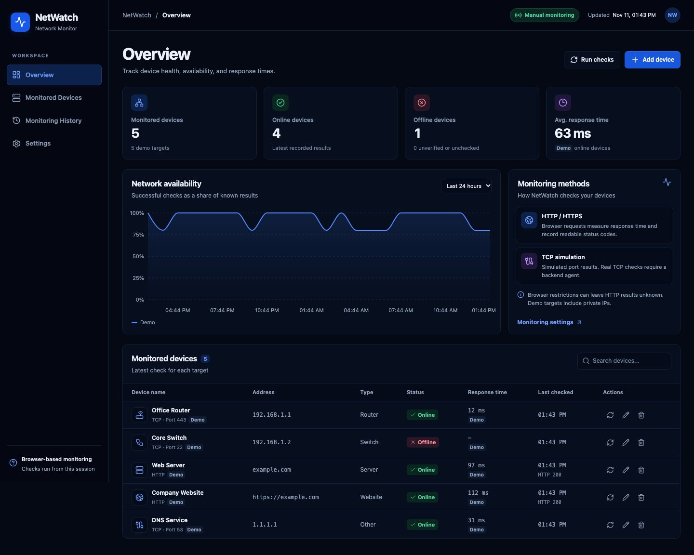

# NetWatch · Network Monitoring Dashboard

NetWatch is a browser-based network monitoring dashboard for a Networking and Communication Systems portfolio. It opens with five sample devices and 48 hours of example checks. Register an HTTP endpoint you can access from your browser to collect your own measurements.

## Run locally

Use Node.js 22.12+ and npm.

```bash
npm ci
npm run dev
```

Open the local URL printed by Vite. To check and build the project:

```bash
npm run lint
npm run build
npm run preview
```

The production output is in `dist/`. It can be hosted as a static site, including on a GitHub Pages project URL. React and Vite handle the app, Tailwind CSS handles styling utilities, Lucide supplies icons, and Recharts renders the charts. No credentials or external monitoring service are required.

## Features

- Overview with device counts, latest response-time averages, and 24-hour or 48-hour availability charts.
- Searchable device inventory with add, edit, delete, and individual or batch checks.
- Device details with recent results, response-time charts, and availability grouped by result source.
- History filters for device, result, and local calendar date.
- Configurable automatic checks, light and dark themes, and controls to clear or restore sample devices.
- Browser-local persistence for devices, settings, and the latest 500 checks. Data is specific to the browser profile and site origin.

## How monitoring works

| Result source | What NetWatch records |
| --- | --- |
| **Measured** | A readable response to a real HTTP(S) `HEAD` request. The check records the HTTP status and elapsed time to response headers. A 2xx response is **Online**. Other readable responses are **Offline** for the HTTP health check, even though a server responded. |
| **HTTP attempt** | **Unknown** when the browser cannot read a response or the five-second timeout expires. Inspect the error details for troubleshooting steps. |
| **Simulated** | A generated TCP result and, for simulated successes, a generated connection time. No socket is opened. |
| **Demo** | Seeded example history. Each sample target is labeled, including the private addresses for Office Router and Core Switch. |

Addresses without a scheme default to HTTPS. Specify `http://` for an HTTP endpoint. Checks omit browser credentials and bypass the HTTP cache. An endpoint that rejects `HEAD` can be reachable while failing this health check.

Cross-origin endpoints must allow the dashboard’s origin through CORS. Fetch can report the same failure for blocked CORS responses, DNS or TLS failures, and connectivity issues. HTTPS-hosted dashboards can also encounter mixed-content restrictions when checking plain HTTP. Private IPs depend on the visitor’s network, routes, and browser permissions. See the [Fetch API guide](https://developer.mozilla.org/en-US/docs/Web/API/Fetch_API/Using_Fetch) and [local network access documentation](https://developer.mozilla.org/en-US/docs/Web/Security/Defenses/Local_network_access).

Automatic monitoring starts disabled. When enabled, it starts a batch only while the tab is visible. Batches check targets sequentially and skip overlapping checks. The schedule stops when the app closes. A regular web page cannot open arbitrary TCP sockets. Genuine TCP checks require a backend monitoring agent on a network that can reach the target.

Availability is the share of known results that are Online, excluding Unknown and Unchecked results. Device details calculate it from retained history, and the overview groups checks into one- or two-hour buckets. The response-time summary averages successful latest checks, preferring measured values when available. Charts and device details keep measured, simulated, and demo values separate.

## Networking concepts demonstrated

| Concept | In the dashboard |
| --- | --- |
| IP addressing | A target can use a hostname or an IP address. DNS resolves hostnames, while reachability to private addresses depends on where the check runs. |
| HTTP and HTTPS | HTTP status codes convey the outcome of a request. HTTPS adds TLS, so certificate and handshake failures can prevent a readable response. |
| TCP ports | A port identifies a service endpoint. The TCP form validates ports from 1 to 65535 and demonstrates how a port check could be represented. |
| ICMP and ping | A standard web page cannot send ICMP Echo requests. A command-line ping and an HTTP health check test different protocols. |
| Latency | HTTP timing reflects the browser’s wait for headers, which can include DNS, connection setup, and server processing. |
| Availability | Recorded check outcomes estimate availability from the browser’s vantage point at sampled times. |
| Troubleshooting | Compare HTTP status, duration, timestamps, and error details. For Unknown results, inspect browser developer tools and verify DNS, TLS, CORS, and routing. |

## Screenshots



## Future improvements

- Add a monitoring agent for genuine TCP and ICMP checks and scheduled monitoring while the dashboard is closed.
- Add response-time thresholds, outage notifications, and history export.
- Compare availability across multiple monitoring locations.
